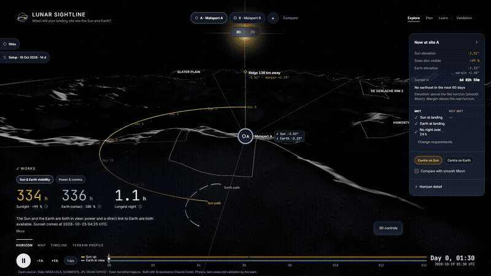
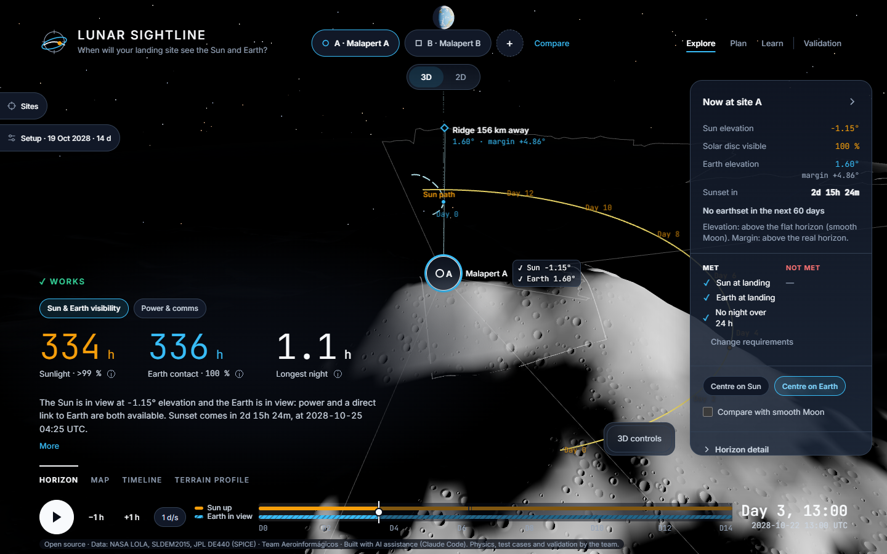
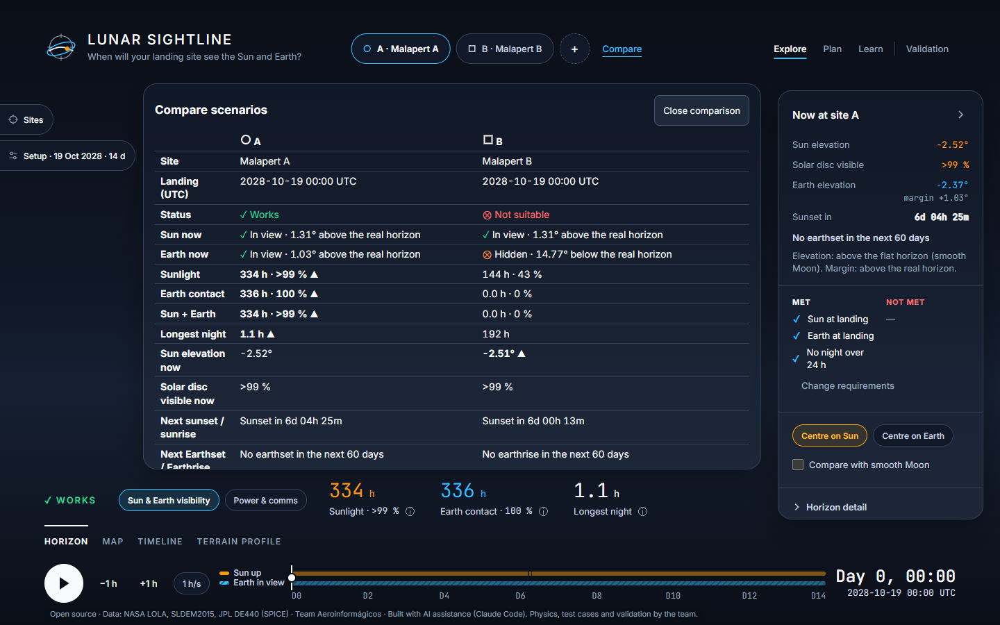
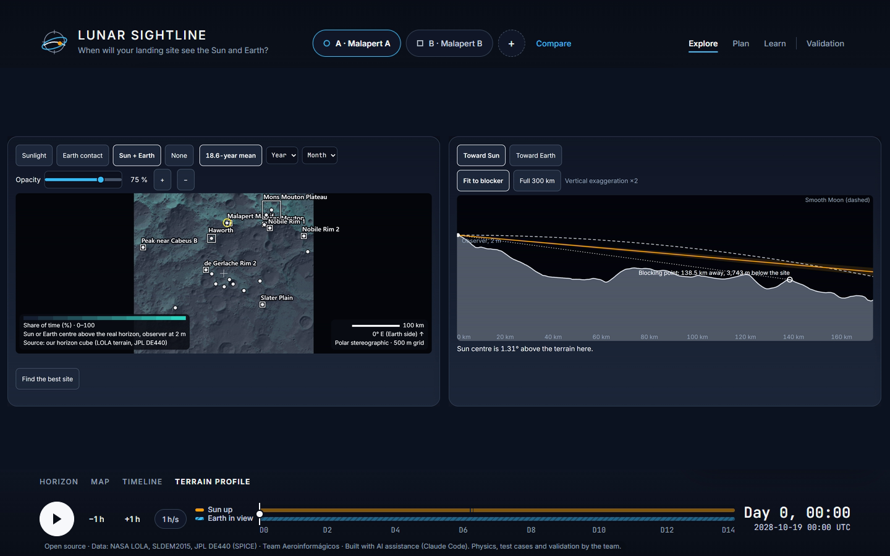
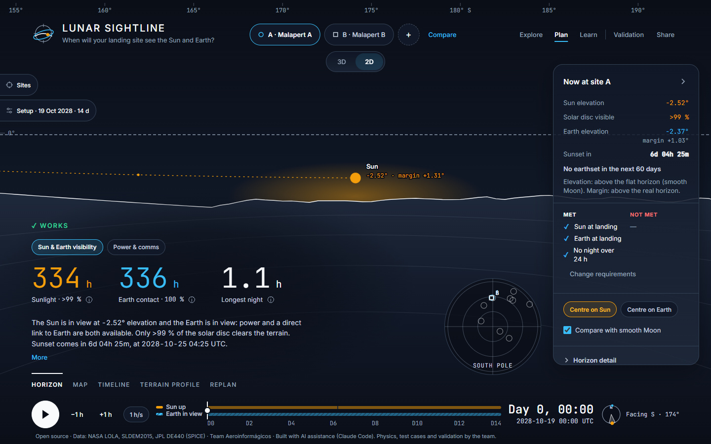
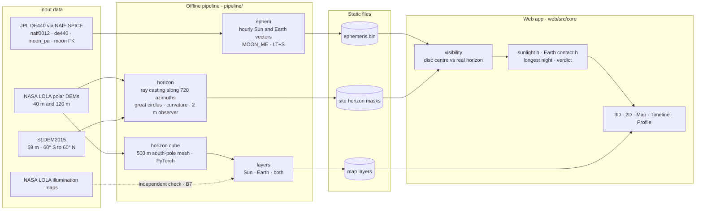
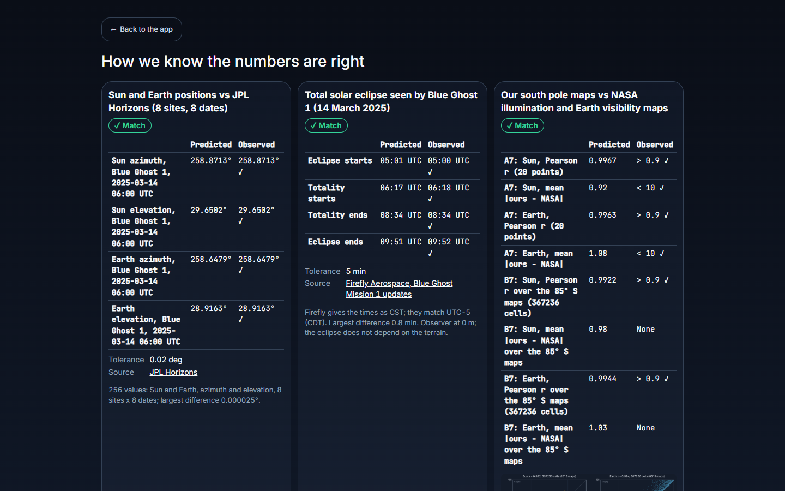

<!-- AI-assisted: written with Claude Code, reviewed by team Aeroinformágicos -->
<div align="center">

# LUNAR SIGHTLINE

### When will your landing site see the Sun and Earth?

The Sun and the Earth over the **real** lunar horizon, for any site and date.
<br/>
Team **Aeroinformágicos** · NASA Space Apps Challenge 2026 · *Lunar Landing Site Navigator* challenge

[](https://lunarsightline.pages.dev)
[](LICENSE)
[](https://github.com/aeroinformagicos/lunar-landing-site-navigator/actions/workflows/ci.yml)
<br/>
[](SOURCES.md)
<br/>


<br/>

<a href="docs/media/sun-timelapse.mp4">
  
</a>
<!-- Drag & drop docs/media/sun-timelapse.mp4 here on GitHub web editor for 60fps native video -->

<sub>Malapert A · 19 Oct 2028 · 14 days at <code>1 d/s</code> with <b>Centre on Sun</b>, recorded from the running app.
Full-quality 1080p clip: <a href="docs/media/sun-timelapse.mp4"><code>sun-timelapse.mp4</code></a></sub>

**[Open the app](https://lunarsightline.pages.dev)** · **[How we check the numbers](https://lunarsightline.pages.dev/#/validation)** · **[Data sources](SOURCES.md)** · **[AI usage log](AI_USAGE.md)**

</div>

---

## At a glance

- ☀️ **Solar power.** Hours of sunlight during the mission and how much of the solar disc clears the terrain.
- 📡 **Direct-to-Earth comms.** Hours with the Earth's centre above the real horizon, so radio has a line of sight.
- 🌑 **Longest night.** The longest stretch without Sun, the figure that decides whether a lander survives.
- ⛰️ **Real topography, not a smooth sphere.** Which ridge blocks the Sun or the Earth, how far away it is, and the margin over it.

Two south-pole sites **710 m apart** load on the first visit: one works, the other does not.
Every figure says which terrain it was computed with; where there is none, the app falls back to a smooth Moon and says so in red.

## Feature tour

<table>
  <tr>
    <td width="50%" align="center">
      
      <br/><b>3D Horizon &amp; Sun Path</b>
    </td>
    <td width="50%" align="center">
      
      <br/><b>Multi-Site Comparison</b>
    </td>
  </tr>
  <tr>
    <td width="50%" align="center">
      
      <br/><b>Terrain Profile &amp; Lunar Map</b>
    </td>
    <td width="50%" align="center">
      
      <br/><b>Mission Constraints &amp; Smooth-Moon Margin</b>
    </td>
  </tr>
</table>

## Modes and views

| | What it does |
| --- | --- |
| **Explore** | Pick a site (landed missions, NASA's 2024 candidate regions, any latitude and longitude), a landing date and a mission length. Switch **3D / 2D**, press **Play**, or use **Centre on Sun / Earth**. |
| **Plan** | Everything in Explore, plus **Replan**: a site × landing-delay matrix, the next valid window and a ranking of candidate regions, with editable requirements. **Share** copies a link that restores the state. |
| **Learn** | A 60-second guided tour in seven steps: why one site works and its neighbour does not, a 12-day launch slip, and how the numbers are checked. |
| **Validation** | The `#/validation` page, generated from the automated test report: our figures against JPL Horizons, Firefly Aerospace's published times and NASA's illumination maps. |
| **Compare** | Puts scenarios A and B side by side with a verdict: `Works`, `Tight` or `Not suitable`. |

| View (bottom strip) | Shows |
| --- | --- |
| **Horizon** | The default: 3D terrain with the Sun and Earth paths, or the 2D real horizon line with the Sun and Earth on it. |
| **Map** | South-pole maps of the share of time with Sun, Earth or both, from our own horizon cube, and **Find the best site**. |
| **Timeline** | Sun and Earth elevation, and every rise and set during the mission. |
| **Terrain profile** | The terrain cut toward the Sun or the Earth, with the blocking point and its distance. |

## How it works

All heavy computation runs **offline in Python**. The web app only reads static files, so there is no server to go down.



<details>
<summary><b>Scientific conventions</b></summary>

<br/>

| Quantity | Convention |
| --- | --- |
| Reference frame | `MOON_ME` everywhere (`IAU_MOON` and `MOON_PA` are rejected by the tests) |
| Ephemerides | JPL DE440 through `naif0012.tls`, `de440.bsp`, `moon_pa_de440_200625.bpc`, `moon_de440_250416.tf`; correction `LT+S` |
| Lunar radius | 1737.4 km; heights in metres above that sphere |
| Coordinates | Planetocentric latitude, east longitude in (−180°, 180°]; azimuth from north through east |
| Observer | 2 m above the ground |
| "Sun" / "Earth contact" | The **centre** of the disc above the real horizon |
| Time | UTC everywhere |
| Coverage | Ephemeris table 1969–1972 and 2024–2044 |

Every constant has a source in [`docs/constants.md`](docs/constants.md) (in Spanish).

</details>

<details>
<summary><b>How a site and date are judged</b></summary>

<br/>

A scenario is a site, a landing time and a mission length (14 days by default).
The traffic light checks three requirements, all **editable in the Replan tab**:

- the Sun's centre is above the real horizon at landing;
- the Earth's centre is above the real horizon at landing (direct line of sight for radio);
- **no night lasts more than 24 h** during the mission (editable from 0 to 400 h).

The 24 h limit is a team default chosen to make differences between nearby sites visible, not a rule of any mission.
For reference, in 2022 NASA chose the candidate regions then planned for Artemis III for access to continuous sunlight over a 6.5-day period (NASA, 19 August 2022),
later refined to about 5.75–6.25 days depending on the mission epoch (NASA Technical Reports Server, 20250011660). Set the limit that matches your own mission.

</details>

<details>
<summary><b>Validation: how we know the numbers are right</b></summary>

<br/>

<p align="center"></p>

The validation page (`#/validation`) is generated from `web/public/data/validation_report.json`:
21 checks; 11 pass, 2 need a person's judgement (one of them an open discrepancy), and 8 are not automated.

| Check | Independent source | Result |
| --- | --- | --- |
| Sun and Earth azimuth and elevation, 8 sites × 8 dates (256 values) | JPL Horizons | largest difference 0.000025° (tolerance 0.02°) |
| Total solar eclipse seen by Blue Ghost Mission 1, 14 March 2025 | Firefly Aerospace's published times | four contacts within 1 min (tolerance 5 min) |
| South-pole maps, 20 random points with their own horizon | NASA LOLA illumination and Earth visibility maps | Pearson r = 0.997 (Sun), 0.996 (Earth) |
| South-pole maps, 367,236 cells of the 85° S maps | same | r = 0.992 (Sun), 0.994 (Earth) |
| Sunrise and sunset times | JPL Horizons | largest difference 0.5 s |
| 13 solar eclipses at (0°, 0°), 2025–2030 | NASA's eclipse catalogue | automated |
| Map layers vs per-site horizons | our own horizon engine | largest difference 0.005° |

Also automated: the horizon of a smooth sphere and of a mountain worked out by hand, geometric sanity checks 2024–2044, invariants of the horizon engine,
and the Blue Ghost 1 replan (works at the real landing, fails 14 days later because of the night). The 122 browser tests check the interface figures against the Python reference.

</details>

<details>
<summary><b>Limitations</b></summary>

<br/>

- **Rise and set times** are only as accurate as the terrain map. Where low relief close to the site sets the horizon, a few metres of map error shift them by tens of minutes at mid-latitudes and by hours near the poles.
- **Longest night near Shackleton:** our best cell gives 147 days of continuous light (published: about 240 days, same order) but a longest night of 11.25 days against about 1.5 days published.
  Shown as "Manual", not as a pass: our maps use one horizon per 500 m cell at 2 m height; the published figure is for the best points at the scale of the LOLA grid.
- **Blue Ghost 1 sunset (16 March 2025)**, the only observed event away from the poles, differs from our prediction by about 40 minutes.
  Firefly's account puts sunset around 18:00–18:15 UTC; our model gives 18:54 UTC. The horizon there is an 11 m rise 800 m away, below what the 59 m map resolves: moving the site one pixel moves our sunset by up to 51 minutes. Shown as an open discrepancy.
- **The 3D view is illustrative:** the terrain is the 500 m polar grid (or, away from the pole, a reconstruction from the site's horizon profile). Every figure comes from the horizon calculation, not from the 3D scene.
- **Maps** cover the south pole on a 500 m grid. **Dates:** 1969–1972 and 2024–2044. **Phones** work in one column; 3D and `Plan` work best on a wider screen.

</details>

## Quickstart

Requires **Git**, **Python 3.12**, **Node.js 24** and, optionally, **GNU Make** (without it, run `npm run <task>` from the repository root).

```bash
git clone https://github.com/aeroinformagicos/lunar-landing-site-navigator.git
cd lunar-landing-site-navigator

make setup     # .venv with pipeline/requirements.txt, npm ci in web/
make dev       # local web app (Vite)
make test      # fast tests: pytest (physics) + vitest (web core) + data contract schemas
```

| Task | Command |
| --- | --- |
| Production build into `web/dist/` | `make build` |
| Static analysis, data contract and bundle size budgets | `make check` |
| Everything, including slow validation and browser tests | `make test-all` (first: `cd web && npx playwright install chromium`) |
| GPU build of the horizon cube (CUDA) | `make setup-gpu` |

The app runs on the committed data in `web/public/data/` and reads the heavy map data from <https://aeroinformagicos-llsn-data.pages.dev>.
The SPICE kernels and elevation models (22.8 GB) are **not** in the repository: set `LLSN_DATA_DIR` to a folder with `kernels/`, `raw/lola/`, `raw/sldem2015/` and `raw/nasa_illum/` (default `./data`).

<details>
<summary><b>Reproduce everything from scratch</b></summary>

<br/>

All commands run from the repository root (`make <task>` or `npm run <task>`) with `LLSN_DATA_DIR` set.
Times were measured on the team's laptop (Windows 11, RTX 4060 Laptop GPU, PyTorch 2.15 with CUDA) on 14 November 2026. On Linux, read `.venv/bin/python` for `.venv/Scripts/python`.

| Step | Command | What it produces | Measured time |
| --- | --- | --- | --- |
| 1. Input data (22.8 GB) | download by hand, see below | `kernels/`, `raw/lola/`, `raw/sldem2015/`, `raw/nasa_illum/` | depends on the network |
| 2. Environment | `make setup` (and `make setup-gpu` for CUDA) | `.venv`, `web/node_modules` | not timed |
| 3. Reference values | `make golden` | JPL Horizons tables in `tests/golden/` (already committed) | 27 s |
| 4. Ephemeris table | `make ephem` | `web/public/data/ephemeris.bin` + meta | 13 s |
| 5. Site masks | `make sites` | horizon masks, profiles, `sites.json` in `web/public/data/` | 0.8–3.3 s per terrain mask, ~1 min for the 20 masks once the SLDEM2015 crops exist |
| 6. Horizon cube, level 1 | `make cube LEVELS=1` | 113 of the 1,974 chunks in `$LLSN_DATA_DIR/out/heavy/cube/` | 2 min 39 s |
| 7. Cube levels 2–4 + map layers | `make night` (= `make cube LEVELS=2,3,4`, then `make layers`) | the other 1,861 chunks; Sun / Earth layers, `map/grid.json`, hillshade, regions | cube 43 min 58 s; layers 9.2 min |
| 8. Compact masks | `make compact` | `compact/regions.bin.gz`, `compact/overview.bin.gz` | not timed (under 5 min expected) |
| 9. NASA map comparison (B7) | `.venv/Scripts/python -m pipeline.cli compare-nasa` | `test_results/B7.json` and two figures | not timed |
| 10. Demo pair | `.venv/Scripts/python -m pipeline.cli pick-demo` | `out/demo_candidates.json` | 412 s |
| 11. Slow validation tests | `make test-all` | `out/test_results/*.json` (A6, A7, B4, B6 and the rest) | Python part 3 min 12 s |
| 12. Validation report | `make report` | `web/public/data/validation_report.json` | seconds |
| 13. Publish heavy data | `make deploy-heavy` | Cloudflare Pages project `aeroinformagicos-llsn-data` (339 MB, 2,045 files) | not timed |
| 14. Publish the app | `make deploy` (CI does it on every merge to `main`) | Cloudflare Pages projects `lunarsightline` and `aeroinformagicos-llsn` | not timed |

Every long step can be resumed: running the same command again skips what is already done.
[`ops/cloud/README.md`](ops/cloud/README.md) explains how to split the cube with a cloud machine. Check any data folder with `.venv/Scripts/python -m pipeline.cli check-contract <dir>`.

**Input data.** Download each file with `curl -L -C - -o <folder>/<file> <url>` (repeat to resume); each `.IMG` has a `.LBL` label at the same URL.

| Folder | Base URL | Files |
| --- | --- | --- |
| `kernels/` | `https://naif.jpl.nasa.gov/pub/naif/generic_kernels/` | `lsk/naif0012.tls`, `spk/planets/de440.bsp`, `pck/moon_pa_de440_200625.bpc`, `fk/satellites/moon_de440_250416.tf` |
| `raw/lola/` | `https://imbrium.mit.edu/DATA/LOLA_GDR/POLAR/IMG/` | `LDEM_80S_40M`, `LDEM_75S_120M`, `LDEM_60S_120M` (`.IMG` + `.LBL`) |
| `raw/sldem2015/` | `https://imbrium.mit.edu/DATA/SLDEM2015/TILES/FLOAT_IMG/` | the `SLDEM2015_512_*_FLOAT` tiles listed in `docs/spec/03_datos_y_fuentes.md` §10.1 (1.4 GB each; only for sites away from the pole) |
| `raw/nasa_illum/` | `https://imbrium.mit.edu/EXTRAS/ILLUMINATION/IMG/` | `AVGVISIB_85S_060M_201608`, `AVGVISIB_85S_060M_201608_EARTH`, `AVGVISIB_75S_120M_201608`, `AVGVISIB_75S_120M_201608_EARTH`, `LPSR_85S_060M_201608` |

The exact byte size of every file is in `docs/spec/03_datos_y_fuentes.md` §10.1; a smaller file is incomplete.
There is no download script and no offline command: to run without a network, `make build` and serve `web/dist/` with any static server (map layers and 3D terrain still come from the heavy origin).

</details>

<details>
<summary><b>Deployments</b></summary>

<br/>

| | URL |
| --- | --- |
| App | <https://lunarsightline.pages.dev> (also <https://aeroinformagicos-llsn.pages.dev>) |
| Previous interface, kept as a safety net | <https://lunarsightline.pages.dev/?ui=v1> |
| Heavy map data (horizon cube, map layers, 3D terrain; read-only, CORS open) | <https://aeroinformagicos-llsn-data.pages.dev> |

The app reads the real map from the heavy origin (`heavy_base_url` in `web/public/config.json`);
the small files in `web/public/data/layers` and `web/public/data/cube` are synthetic samples for the automated tests.

</details>

## Project structure

```text
.
├── pipeline/       Python offline pipeline: ephemerides, terrain, horizon masks, cube, layers, reference visibility
├── web/            React + TypeScript static app (src/core is the pure computation core; e2e/ holds Playwright tests)
├── contract/       Data contract between pipeline and web: version, JSON schemas, examples, site catalogue
├── ops/            Task runner (tasks.mjs), JPL Horizons reference download, deployment, cloud cube runs
├── tests/golden/   Reference values from independent sources (JPL Horizons, published events)
├── docs/           Team documentation (in Spanish): specification, task cards, decisions, constants
│   └── media/      README screenshots and the Sun timelapse
├── Makefile        Thin wrapper over ops/tasks.mjs (same targets as `npm run`)
└── SOURCES.md      Every data source, paper and library, with URL and licence
```

## Data and credits

| | Used for |
| --- | --- |
| **JPL DE440** ephemerides via **NAIF SPICE** kernels (frame `MOON_ME`) | Sun and Earth positions seen from the site |
| **NASA LOLA** polar digital elevation models (LRO LOLA Team, NASA GSFC; 40 m within 80° S, 120 m to 60° S) | Horizon masks near the south pole, the horizon cube and the map layers |
| **SLDEM2015** (LOLA + SELENE Terrain Camera; Barker et al. 2016, 59 m at the equator) | Horizon masks between 60° S and 60° N |
| NASA LOLA illumination and Earth visibility maps (Mazarico et al. 2011, PGDA) | Independent check of our south-pole maps (cases A7 and B7) |
| JPL Horizons · Firefly Aerospace · NASA eclipse catalogue | Reference values for the validation |
| NSSDCA landing table, IAU/USGS gazetteer, NASA's 2024 candidate regions | Site catalogue |

Built by **Team Aeroinformágicos** for the NASA Space Apps Challenge 2026. The full list of sources, with URLs, licences and software libraries, is in [SOURCES.md](SOURCES.md).
NASA is named only as a data source: no NASA logo or mission insignia appears in the app or in this repository's images.

## Use of AI

Built with the help of generative AI, as allowed by the Space Apps 2026 rules.

- **Tool:** Claude Code (Anthropic) wrote most of the source code, tests, configuration and deployment scripts, and helped write the specification (`docs/spec/`), the task cards and this documentation, always from the team's instructions and decisions.
- **What people did:** the team chose the problem, the physics, the conventions, the test cases, their tolerances and the reference values, which come from independent sources (JPL Horizons, Firefly Aerospace, NASA's eclipse catalogue and illumination maps), never from our own code.
- **Review:** every change goes through a pull request reviewed and merged by a team member. Decisions the AI took unsupervised are signed as such in `docs/decisions.md` and wait for a person to read them.
- **Disclosure:** every source file starts with `AI-assisted: written with Claude Code, reviewed by team Aeroinformágicos`, commits carry an `AI-assisted: Claude Code` trailer, and the app's footer says so too.
- **Log:** [AI_USAGE.md](AI_USAGE.md) records, task by task, what the AI generated and what a person reviewed. Any AI-generated image used in the presentation is marked as AI-generated.
- **Media:** the screenshots and the timelapse in `docs/media/` are captures of the running app, not generated images.

## License

Code: [MIT](LICENSE), © 2026 Aeroinformágicos. Derived data (ephemeris table, horizon masks, maps) are published with the citation of their sources ([SOURCES.md](SOURCES.md)); the input data keep their own terms (NASA and JPL data are public).
